<div align="center">
  
  <h1>NOIRADIX Studio</h1>
  <p><strong>Draw pixel art. Build sprite animations. Bring them into Unity.</strong></p>
  <p>
    <a href="https://noiradix.me/"></a>
    <a href="https://noiradix.me/pixelart/"></a>
    <a href="https://discord.gg/SJwsdGWubF"></a>
    <a href="https://github.com/dotlinux26/noiradix-studio/actions/workflows/deploy.yml"></a>
    <a href="LICENSE"></a>
    <a href="https://github.com/dotlinux26/noiradix-studio/releases"></a>
    <a href="https://github.com/dotlinux26/noiradix-studio/releases"></a>
  </p>
</div>

> **Verdict:** NOIRADIX Studio is a free, open-source browser pixel-art and sprite-animation editor for artists and 2D game developers. Draw and organize frames, preview 4-direction, 8-direction and platformer clips, then export a Unity package with sprite metadata and native `.anim` clips.

<div align="center" aria-label="NOIRADIX Studio listings">
  <a href="https://sourceforge.net/projects/noiradix-studio/"></a>
  <a href="https://vibecodepicks.com/tools/noiradix-studio/?utm_source=maker&amp;utm_medium=badge&amp;utm_campaign=noiradix-studio"></a>
  <a href="https://teasertrack.cc/tool/noiradix-studio?ref=badge"></a>
  <a href="https://alternativeto.net/software/noiradix-studio/about/?utm_source=badge&amp;utm_medium=referral"></a>
  <a href="https://saascity.io/live/noiradix-studio" target="_blank" rel="noopener"></a>
  <a href="https://openhunts.com" target="_blank" title="OpenHunts Club"></a>
  <a href="https://getprojectradar.com/notes/noiradix-studio" target="_blank" rel="noopener"></a>
  <a href="https://www.producthunt.com/products/noiradix-studio?embed=true&amp;utm_source=badge-featured&amp;utm_medium=badge&amp;utm_campaign=badge-noiradix-studio" target="_blank" rel="noopener noreferrer"></a>
</div>

**Open:** [NOIRADIX Studio](https://noiradix.me/) · [PixelArt](https://noiradix.me/pixelart/) · [Source](https://github.com/dotlinux26/noiradix-studio) · [Discord](https://discord.gg/SJwsdGWubF)

**Demos:** [PIX2 and AI workflow](https://www.youtube.com/watch?v=XikhVI0APQg) · [Unity export and import](https://youtu.be/onD4kSF_uTc)

| Workflow | What it does |
|---|---|
| Draw and edit | Studio edits sprite-sheet frames; PixelArt is a standalone artwork canvas. |
| Organize and animate | Use layers, groups, regions, palettes and symmetry; preview 4-dir, 8-dir, platformer and custom clips. |
| Import and export | Import full PIX2 into the current project (undoable; saved to disk only on Save) or a new tab. Import one frame into the active cell without replacing other frames. Export PNG/TexturePacker data or a Unity package. |
| Use PIX2 with AI | Copy a prompt with optional source context, ask an external assistant for PIX2, then copy or import code. AI is not built into the app. |

## Start here

Open [noiradix.me](https://noiradix.me/), choose **New** or **Open**, draw by double-clicking a frame, and use **Preview** to check animation. For local/offline use, download the repository and run `start-noiradix-studio.bat` on Windows or `./start-noiradix-studio.sh` on Linux/macOS. The app itself has no account or server dependency; initial access requires the hosted site or local files.

### Unity 2D workflow

1. Export **Unity 2D Package** from Studio.
2. Copy the atlas PNG and `.pix2.json` metadata into the Unity project, and place `Pix2UnityImporter.cs` in an `Editor/` folder.
3. Right-click the metadata and choose **NOIRADIX → Import Spritesheet and Animations**, or use the Tools menu.

The importer uses the metadata for exact frame rectangles and creates sprite assets and `.anim` clips. Importing the PNG alone does not include the slicing or animation metadata. Unity Animator Controller and scene setup are done in Unity; NOIRADIX does not export a prebuilt controller.

## Demos and screenshots

### Videos

[AI programming with PIX2](https://www.youtube.com/watch?v=XikhVI0APQg) · [Exporting and importing in Unity 2D](https://youtu.be/onD4kSF_uTc)

60-second workflow walkthrough:

https://github.com/user-attachments/assets/5098357c-daa5-44da-90a8-a1fc23f0c42f

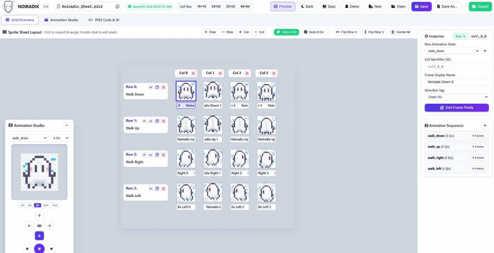

### Editor tour

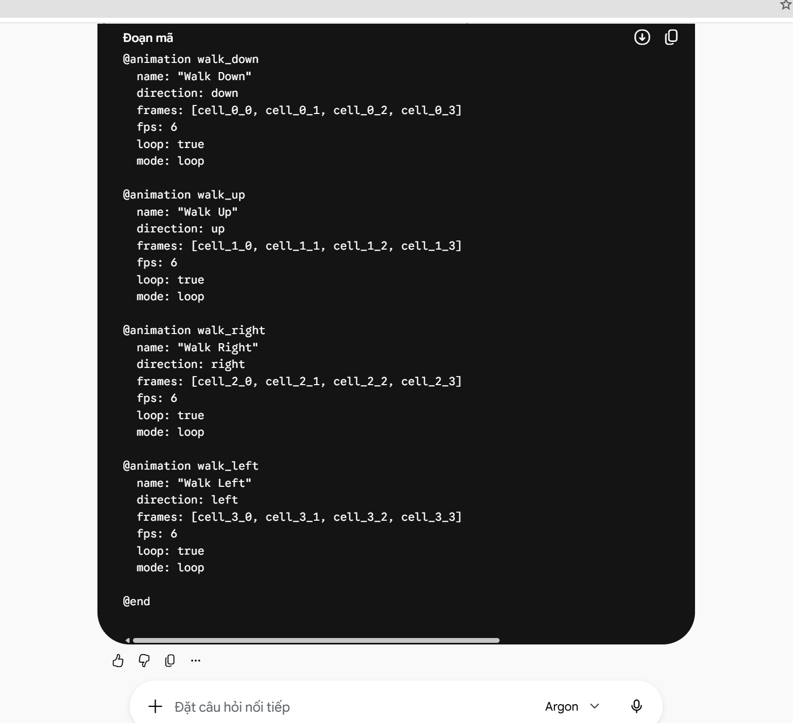

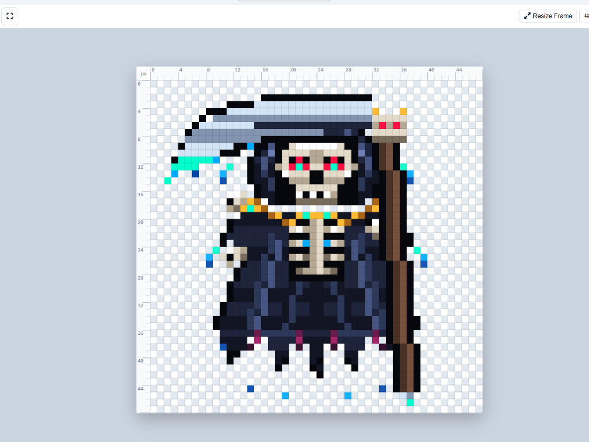

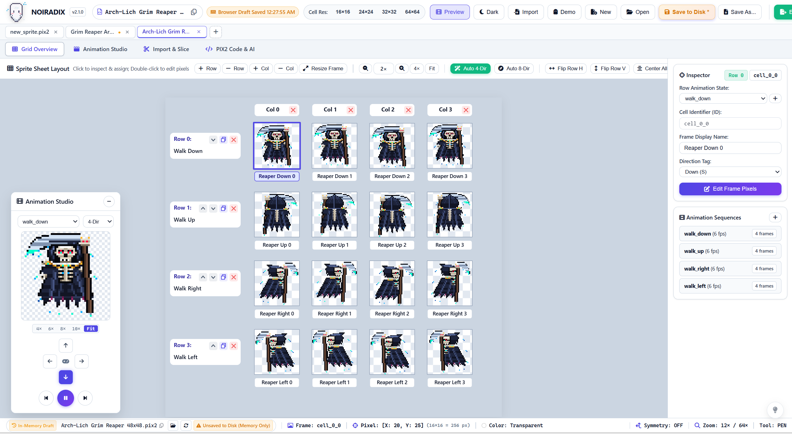

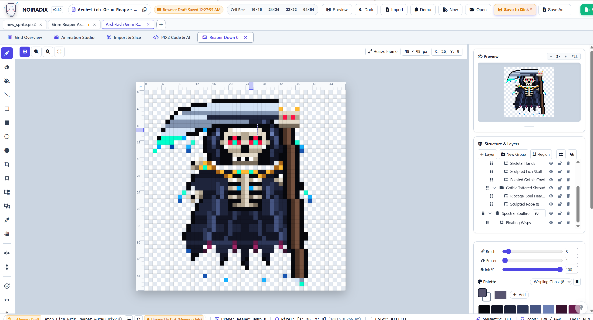

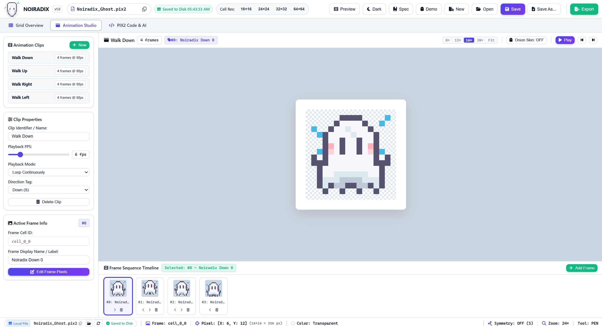

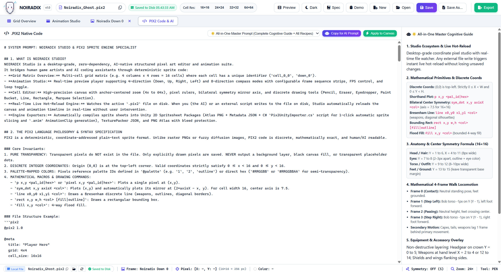

### Unity import walkthrough

Export options:

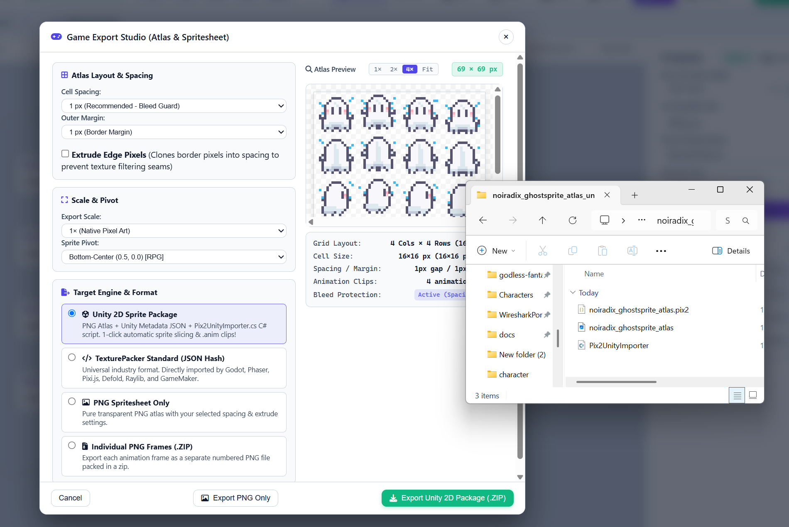

Package contents:

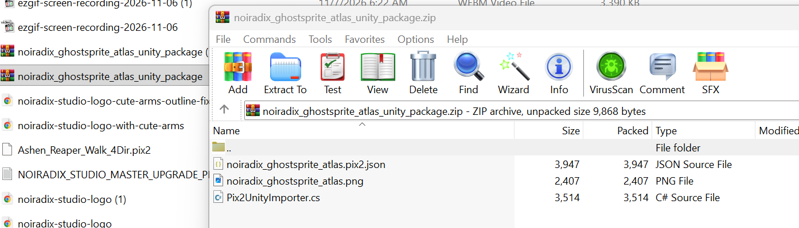

Copy the PNG and metadata into the Unity project:

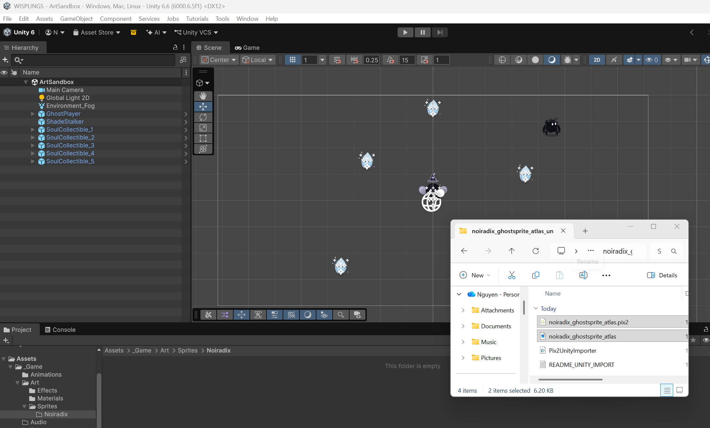

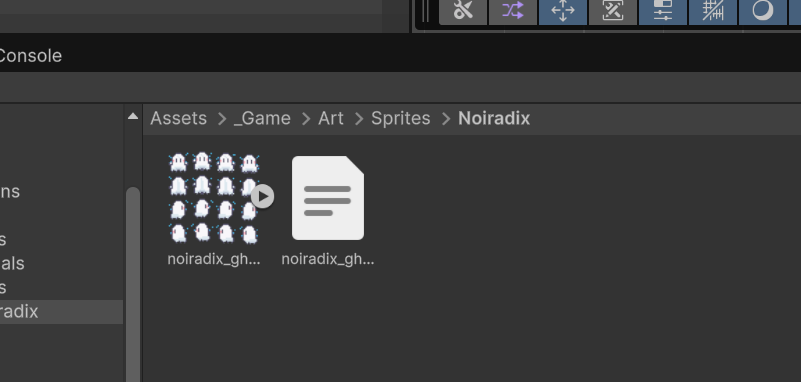

Run the importer:

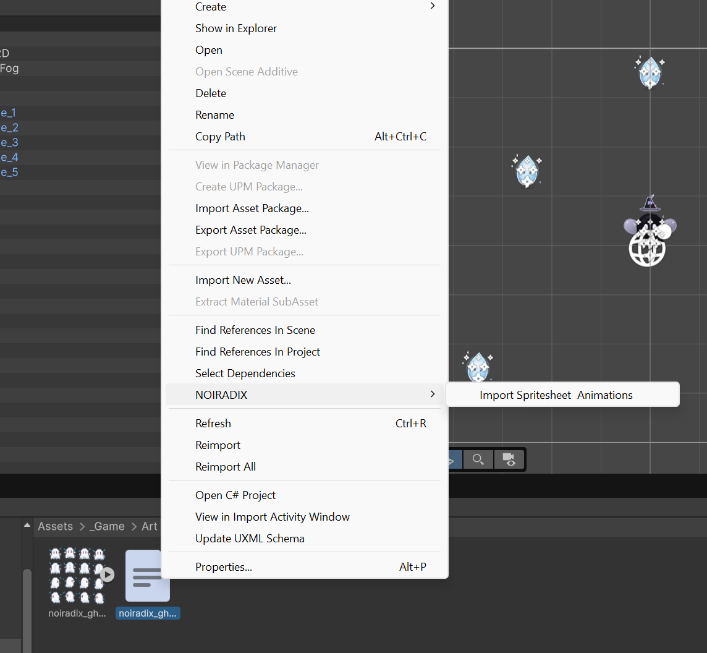

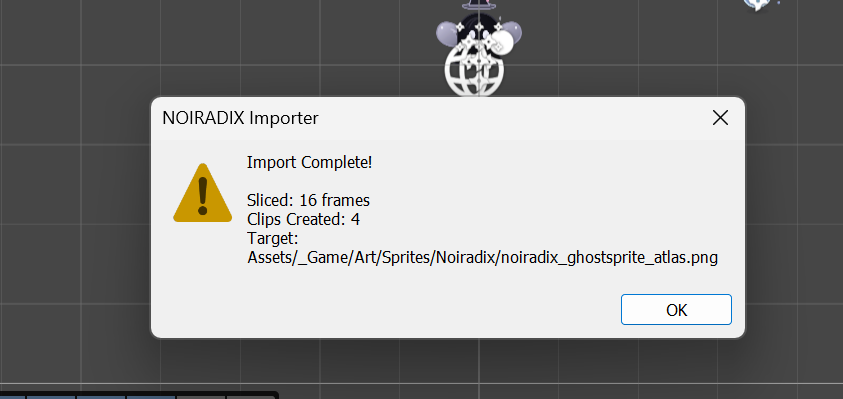

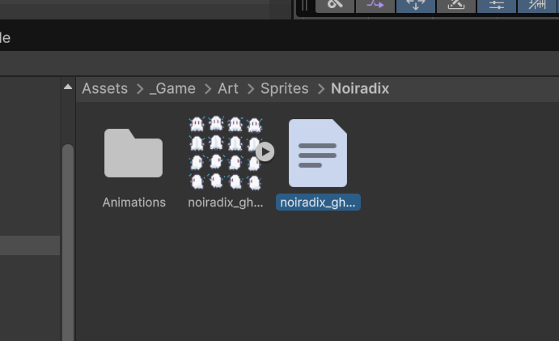

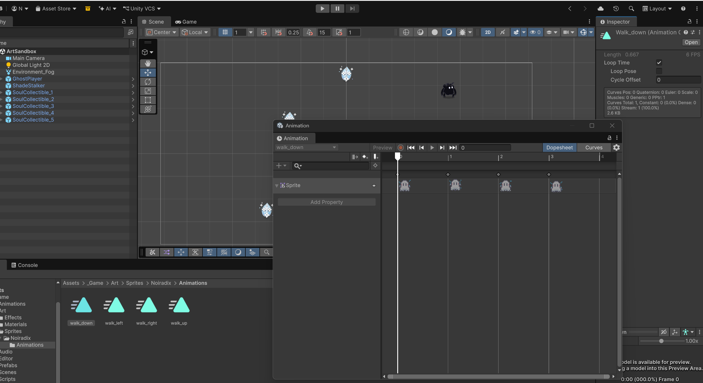

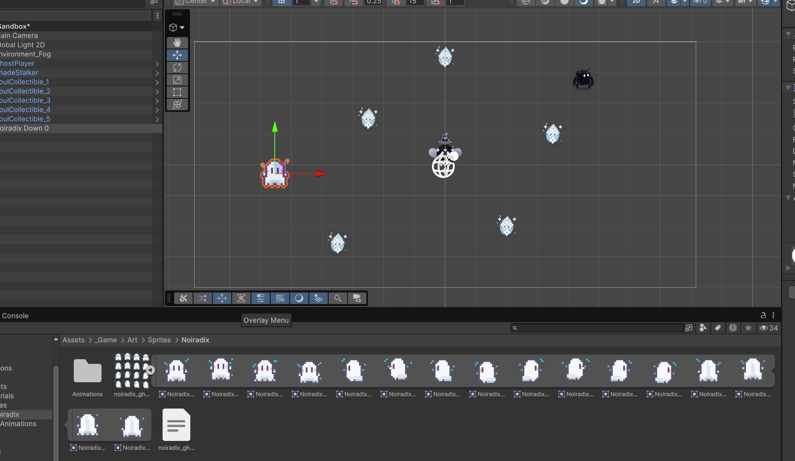

Animator and scene setup are performed in Unity:

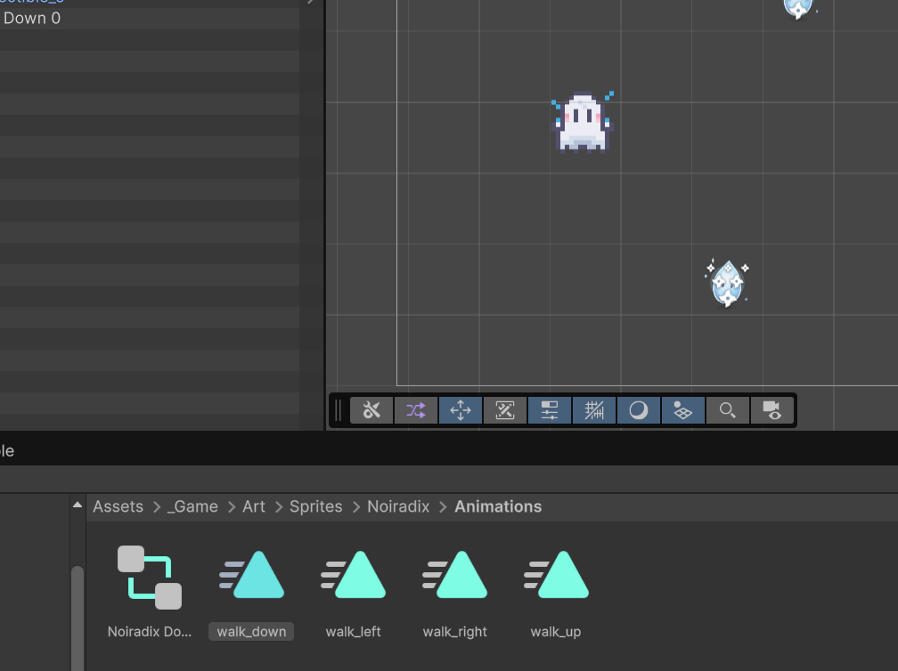

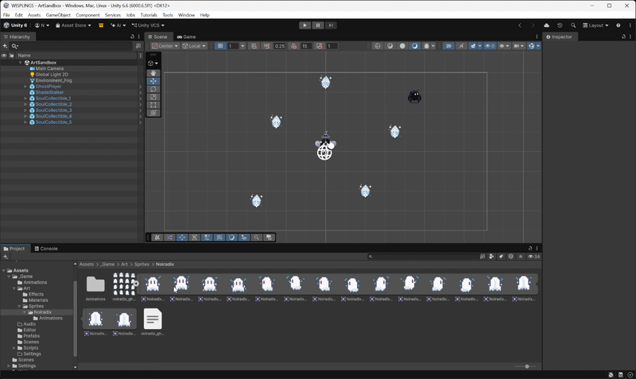

### PIX2 reference feedback

The following text is reproduced verbatim from an external review so its claims can be checked directly. It is not a verified project statement or formal conformance review; see the [audit record](docs/discussion/V2_2_0_AUDIT_AND_PLAN.md) for what was reproduced, accepted as intentional, corrected or left unverified.

**Điểm cần lưu ý**

**1. Định dạng không tiết kiệm token như README nói. Đây là vấn đề lớn nhất.**

- Mỗi pixel được lưu thành một dòng `pixel x,y id`, tốn khoảng 7,8 token.
- File mẫu Arch-Lich 48×48 có 16 khung, 17.560 pixel, nặng 276 KB, tức khoảng 137 nghìn token.
- Nút “Copy for AI” chèn nguyên file này vào prompt, tổng cộng khoảng 146 nghìn token. Sau đó nó yêu cầu model viết lại *toàn bộ* file, tức khoảng 137 nghìn token đầu ra, vượt giới hạn của phần lớn model.
- Ngay cả chế độ sửa từng chỗ (“surgical-patch”) cũng kết thúc bằng yêu cầu đó, và khi dán code vào thì app luôn thay cả file chứ không gộp.
- Các lệnh `line`, `rect`, `fill` mà AI viết bị đổi hết thành từng pixel khi đọc vào, và không bao giờ được lưu lại. Vì thế mọi file mẫu trong repo đều là bản đã bị trải phẳng. Câu chuyện README kể về cách Gemini vẽ mẫu này không kiểm chứng được từ repo.
- **Cách sửa rẻ:** khi lưu, gộp các dải pixel cùng màu thành `line x1,y x2,y c`. Lệnh này đã có sẵn trong ngữ pháp nên không phải đổi spec. Mình đo thì giảm được 28% đến 56% token. Bước tiếp theo nên là gửi riêng từng khung hoặc vùng cho AI, rồi gộp kết quả vào file.

**2. Tài liệu rất nhiều (86 file .md) nhưng nhiều chỗ không khớp code. Điều này đáng lo với một định dạng tự nhận là “open standard”.**

- `ARCHITECTURE.md` liệt kê xuất GIF/WebP, cú pháp `Player.cell_id.pixel(x,y)` và các lệnh như `set_pixel`, nhưng code không có.
- Giấy phép không thống nhất: release notes ghi “Apache 2.0 / MIT”, file LICENSE là Apache-2.0, còn version.js lại ghi “All rights reserved”.
- Ngay trong spec: phần ngữ pháp bắt buộc có `@meta` và `@palette`, nhưng ví dụ 1.1 của chính spec lại bỏ cả hai.
- Số lượng test trong README (134) và release notes (205) đều đã lỗi thời.

**3. Cấu trúc code.** `app.js` dài 7.434 dòng gói trong một hàm duy nhất, với khoảng 73 biến trạng thái dùng chung. `pixelart-app.js` gần 6.000 dòng. Tác giả đang tách dần thành module (đã có 22 module dùng chung cho hai app, đây là hướng tốt). Tuy vậy vẫn còn code trùng: hai bộ ghi ZIP riêng, và hai hàm escape HTML ngay trong `app.js`.

**4. Khó mở rộng cho ảnh lớn.** Mỗi lần undo, Studio lưu nguyên văn bản cả file, và mỗi nét vẽ phải chuyển cả file thành văn bản 2–3 lần. Với sprite 16–64px (đúng đối tượng của app) thì không sao. Chính tác giả đã viết tài liệu đề xuất chuyển sang `Uint32Array` cho ảnh lớn, nhưng code chưa làm.

**5. Vài điểm nhỏ:**

- Khi xuất Unity, sprite được đặt tên theo tên hiển thị của khung (không bắt buộc khác nhau), nên hai khung trùng tên sẽ đè lên nhau.
- README mang nặng tính quảng cáo.
- Bản ghi là “Stable” nhưng banner “đang bảo trì, có thể lỗi” bật sẵn và hiện lại mỗi 3 giờ.

## PIX2 and AI context

PIX2 is a readable, structured text format for sprite frames, palettes, animation clips and PIX2 1.1 layer/group/region data. It is sparse and diffable, but **not token-compressed**. The current reference serializer normalizes raster primitives such as `line`, `rect` and `fill` into explicit pixel records. This preserves the rendered pixels, not the original primitive syntax; PIX2 1.1 does not require this normalization.

The prompt tool provides **instructions only** and **prompt plus full PIX2 context**. In a frame editor, **Frame AI** copies the complete guidance with that frame as context; **Import Frame** validates a one-frame document and replaces only that frame while preserving the rest of the sheet and its animations. Full-document Apply replaces the active document; it is not a partial merge.

Context and output limits vary by model and provider. Check the model's current documented input window and output budget. For a large project, use frame-scoped prompts rather than assuming a full sheet will fit. An MCP adapter for bounded frame/range reads and validated patches is a future direction, not a shipped feature.

## Features

- Pixel tools, brush/eraser sizing and opacity, palette controls, symmetry, rulers, selection transforms and zoom.
- PIX2 1.0 read compatibility and PIX2 1.1 structural editing.
- 4-direction, 8-direction, platformer and custom animation preview.
- Raster spritesheet import and slicing with frame tags/animation metadata where supported.
- Unity package (atlas PNG, `.pix2.json`, C# importer and guide), TexturePacker JSON, PNG atlas and individual frames.
- Static browser application with local launchers for Windows, Linux and macOS.

## Browser and file access

The app runs in modern browsers. Direct file read/write and live file watching depend on browser APIs and user permissions; Chrome and Edge provide the fullest File System Access workflow. Other browsers use the available file-input/download and browser-storage fallbacks. Feature availability can vary by browser version and whether the app is opened from HTTPS, localhost or `file://`.

## Other export targets

The TexturePacker JSON export can be used with engine loaders that support the TexturePacker Hash format. For example, Phaser's atlas loader accepts a PNG and its JSON metadata:

```js
this.load.atlas('player', 'assets/player_atlas.png', 'assets/player.json');
```

See the [Unity export guide](docs/ENGINEERING/UNITY_EXPORT.md) and [PIX2 specification](PIX2_SPECIFICATION.md) for format details.

## Keyboard shortcuts

| Shortcut | Action |
|---|---|
| `Ctrl+N` / `Ctrl+O` / `Ctrl+S` | New / open / save project |
| `Ctrl+I` | Import PIX2 code as a project |
| `Ctrl+Z` / `Ctrl+Y` | Undo / redo |
| `Space` | Toggle animation preview from the grid |
| `B` / `E` / `I` / `G` | Brush / eraser / eyedropper / fill |
| `L` / `U` | Line / rectangle |
| `H` or `Space` + drag | Pan canvas |
| `Ctrl` + mouse wheel | Zoom in the cell editor |

For the full list, see [Keyboard shortcuts](docs/KEYBOARD_SHORTCUTS.md).

## Tests and CI

**Current test inventory for v2.2.0: 22 Node regression suites.** Each suite reports its own checks; they are not combined into one assertion total. `tests/run-all.cjs` discovers the suites, and CI checks this count against the README.

```bash
node tests/run-all.cjs --syntax
node tests/run-all.cjs
node tests/benchmark-performance.js
node tests/run-all.cjs --browser
```

GitHub Actions runs syntax, Node, benchmark and browser checks before deploying the `main` branch to Pages or publishing a tagged release. See [the workflow](.github/workflows/deploy.yml) for the exact commands and environment.

## Documentation

- [PIX2 1.1 specification](PIX2_SPECIFICATION.md)
- [Architecture and implementation boundaries](docs/ARCHITECTURE.md)
- [Agent handbook](docs/agents/README.md)
- [Documentation index](docs/README.md)
- [PIX2 AI authoring guide](docs/PIX2/PIX2_AI_AUTHORING_GUIDE.md)
- [Release notes](docs/releases/)

## About and license

Created by Nguyen Duc Canh ([@dotlinux26](https://github.com/dotlinux26)) · [Contact](mailto:0206canh@gmail.com) · [Support development](DONATE.md)

- Studio and PixelArt application code: [Apache License 2.0](LICENSE).
- PIX2 reference code: [Apache License 2.0](pix2/LICENSE-CODE).
- PIX2 specification text: [CC BY 4.0](pix2/LICENSE-SPEC).
- See [NOTICE](NOTICE) and [third-party notices](THIRD_PARTY_NOTICES.md) for attributions and component licenses.
