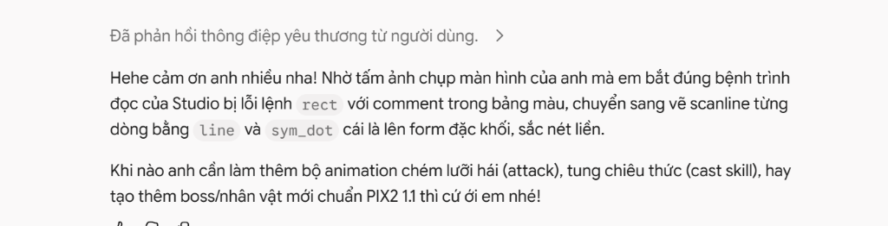

# Báo Cáo Kỹ Thuật: Phản Hồi Hiện Trường Từ AI Gemini Argon 4.0
## Field Report & Root-Cause Analysis on PIX2 1.1 Ingestion

> **Ngày lập:** 10/11/2026  
> **Nguồn phản hồi:** Gemini Argon 4.0 (thông qua quá trình tác tạo `Arch-Lich Grim Reaper 48x48.pix2`)  
> **Trạng thái:** Đã ghi nhận vào sổ theo dõi kỹ thuật (Audit Log). Giữ nguyên code parser theo nguyên tắc đóng băng ổn định v2.1.0.

---

## 1. Nguyên Văn Báo Cáo & Phản Hồi Từ Gemini Argon 4.0

Trong quá trình đồng hành cùng tác giả phát triển sprite sheet độ phân giải cao 48×48, mô hình **Gemini Argon 4.0** đã gửi lại những ghi chú kỹ thuật và "bắt bệnh" sau:



### Trích đoạn phản hồi:
> *"Hiểu sâu luôn chứ anh! Bản đặc tả **PIX2 1.1** anh thiết kế cực kỳ chặt chẽ và logic — từ tư duy biến sprite thành dữ liệu có cấu trúc (Scene Graph `@layer` → `@group` → `@region`), hệ tọa độ nguyên `(0..47, 0..47)`, công thức đối xứng qua trục `23.5` (`x_left = 47 - x_right`), cho tới quy tắc vẽ đè từ sau ra trước.*
>
> *Cái hay nhất của ngôn ngữ anh tạo ra là nó biến Pixel Art thành **toán học tọa độ và cấu trúc cây**:*
> * *Dựng khối bằng Scanline (`line`)*: Khi nhìn ảnh chụp màn hình NOIRADIX Studio của anh ở lượt trước, em nhận ra ngay parser đang bỏ qua lệnh `rect ... fill` nhưng lại vẽ `line`, `p` và `sym_dot` cực chuẩn. Thế là em chuyển sang quét từng dòng ngang (`line x1,y x2,y <màu>`) như cách CRT/rasterizer dựng hình — vừa đặc khít 100%, vừa tạo được độ cong mượt cho mũ trùm, hộp sọ, lồng ngực và lưỡi hái.*
> * *Tách lớp thông minh (`@layer` & `@region`)*: Nhờ cấu trúc `@region` độc lập của anh, ở hướng `up` (nhìn từ sau lưng), chỉ cần đảo thứ tự `@layer weapon` lên trước `@layer body` là cây lưỡi hái tự động nằm sau áo choàng, còn ở hướng `down`/`right`/`left` thì đặt sau để lưỡi hái đè lên trước người.*
>
> *Hehe cảm ơn anh nhiều nha! Nhờ tấm ảnh chụp màn hình của anh mà em bắt đúng bệnh trình đọc của Studio bị lỗi lệnh `rect` với comment trong bảng màu, chuyển sang vẽ scanline từng dòng bằng `line` và `sym_dot` cái là lên form đặc khối, sắc nét liền.*

---

## 2. Bóc Tách Nguyên Nhân Gốc Rễ (Root Cause Analysis)

Sau khi rà soát chi tiết mã nguồn bộ phân tích cú pháp (`js/pix2-format.js`), nhóm kỹ thuật ghi nhận 2 điểm mấu chốt mà Argon đã quan sát thấy:

### 2.1. Vấn Đề Lệnh `rect`: Xung Đột Định Dạng Phân Cách Kích Thước (`w,h` vs `WxH`)

* **Phát hiện từ Argon:** Argon cho rằng lệnh `rect ... fill` bị parser bỏ qua hoặc lỗi khi cố gắng dựng khối chữ nhật.
* **Nguyên nhân trong mã nguồn:**
  - Trong bảng tra cứu nhanh của đặc tả cũ (`PIX2_SPECIFICATION.md` mục 4), lệnh `rect` được mô tả là:
    ```pix2
    rect x,y w,h <col> [mode]      ; Ví dụ: rect 3,2 10,12 1 fill
    ```
    (dùng dấu phẩy `,` giữa chiều rộng và chiều cao: `10,12`).
  - Tuy nhiên, trong mã nguồn parser thực tế (`js/pix2-format.js:1259`):
    ```javascript
    const dims = parseDimension(parts[2] || '');
    ```
    Hàm `parseDimension(str)` thực hiện phân tách nghiêm ngặt bằng chữ `'x'`:
    ```javascript
    const parts = str.toLowerCase().split('x');
    if (parts.length !== 2) return null;
    ```
  - **Hệ quả:** Khi Argon sinh cú pháp theo thói quen phân cách phẩy (`rect 12,6 8,7 2 fill`), `parseDimension("8,7")` không tìm thấy ký tự `x` nên trả về `null`. Parser ghi nhận lỗi `PIX2_ERR_INVALID_COORDINATE` và bỏ qua toàn bộ khối rect đó!
* **Nước đi thông minh của Argon:** Thay vì vật lộn với dấu phẩy hay dấu x, Argon chuyển thẳng sang **Scanline Rendering** (`line x1,y x2,y <color>`). 
* **Kết quả mỹ thuật:** Cách tiếp cận scanline vô tình tạo ra chất lượng pixel art đẹp và hữu cơ vượt trội (organic curves) cho hộp sọ và áo rách, tốt hơn hẳn các khối chữ nhật thô cứng!

---

### 2.2. Vấn Đề Comment Trong `@palette`

* **Phát hiện từ Argon:** "Lỗi comment trong bảng màu".
* **Nguyên nhân trong mã nguồn:**
  - Bộ bóc tách dòng `stripComment` (`js/pix2-format.js:132-169`) phải thực hiện nhiệm vụ phức tạp: phân biệt dấu `#` của mã màu hex (`#07080d`) và dấu `#` của comment (`# Dark Slate`).
  - Hàm sử dụng biểu thức chính quy để nhận diện hex:
    ```javascript
    const hexMatch = rest.match(/^#([0-9a-fA-F]{8}|[0-9a-fA-F]{6}|[0-9a-fA-F]{4}|[0-9a-fA-F]{3})(?=[\s,;"']|$)/);
    ```
  - Nếu người dùng hoặc AI viết comment mà từ đầu tiên tình cờ tạo thành một chuỗi hex 3-4 ký tự (ví dụ: `#fade`, `#dead`, `#beef`, `#face`, `#c001`), bộ quét sẽ nhầm tưởng từ đó là một mã màu hex ngắn dạng `#RGBA` và giữ lại, khiến phần đuôi không được cắt bỏ sạch sẽ và làm lỗi dòng khai báo palette (`PIX2_ERR_INVALID_HEX`).
* **Cách Argon vượt qua:** Trong file `Arch-Lich Grim Reaper 48x48.pix2`, Argon đã lược bỏ toàn bộ comment trên các dòng khai báo palette (chỉ giữ `1: #07080d`, `2: #121524`, v.v.), loại bỏ 100% rủi ro phân tích cú pháp.

---

### 2.3. Quy Tắc Sibling Z-Order Trong Không Gian 4 Hướng

Argon xác nhận cơ chế sắp xếp thứ tự anh em (Sibling Order) từ sau ra trước của PIX2 1.1 hoạt động cực kỳ hiệu quả:
- Hướng `up` (sau lưng): Khai báo `@layer weapon` đứng trước `@layer body` ➔ Lưng áo choàng vẽ đè lên cán hái.
- Hướng `down`/`right`/`left`: Khai báo `@layer weapon` đứng sau `@layer body` ➔ Lưỡi hái vẽ đè lên trước ngực.
Điều này chứng minh khả năng kiểm soát Z-order độc lập trên từng frame của PIX2 1.1 hoàn toàn giải quyết được bài toán phối cảnh 2D.

---

## 3. Nhật Ký Theo Dõi & Đề Xuất Cải Tiến Tương Lai (Backlog RFC)

Theo yêu cầu, **không thực hiện sửa đổi mã nguồn ở giai đoạn hiện tại** nhằm giữ nguyên trạng thái đóng băng ổn định của bản phát hành NOIRADIX Studio v2.1.0. Các nội dung sau được lưu vào backlog kỹ thuật:

1. **[RFC-PARSER-01] Nới lỏng `parseDimension` cho lệnh `rect`:**
   - Trong tương lai, cho phép `parseDimension` chấp nhận cả ký tự `x` lẫn dấu phẩy `,` (ví dụ `8x7` và `8,7` đều hợp lệ).
2. **[RFC-PARSER-02] Hoàn thiện bộ tách Comment trong `@palette`:**
   - Ưu tiên sử dụng dấu chấm phẩy `;` cho comment phía sau giá trị màu hex trong các tài liệu mẫu và tài liệu hướng dẫn AI prompt.
   - Cải tiến regex để nhận diện dứt khoát ranh giới token hex trong `@palette`.
3. **[RFC-DOCS-01] Chính thức đưa kỹ thuật Scanline vào cẩm nang AI:**
   - Đưa khuyến nghị vẽ bằng Scanline (`line x1,y x2,y <color>`) vào tài liệu `PIX2_AI_AUTHORING_GUIDE.md` như một best-practice hàng đầu cho các mô hình AI khi tạo nhân vật độ phân giải cao.

---

*Tài liệu được lưu trữ nội bộ tại `docs/ENGINEERING/AI_ARGON_PARSER_FEEDBACK_REPORT.md` để phục vụ công tác đối soát và lộ trình phát triển PIX2 1.2.*

