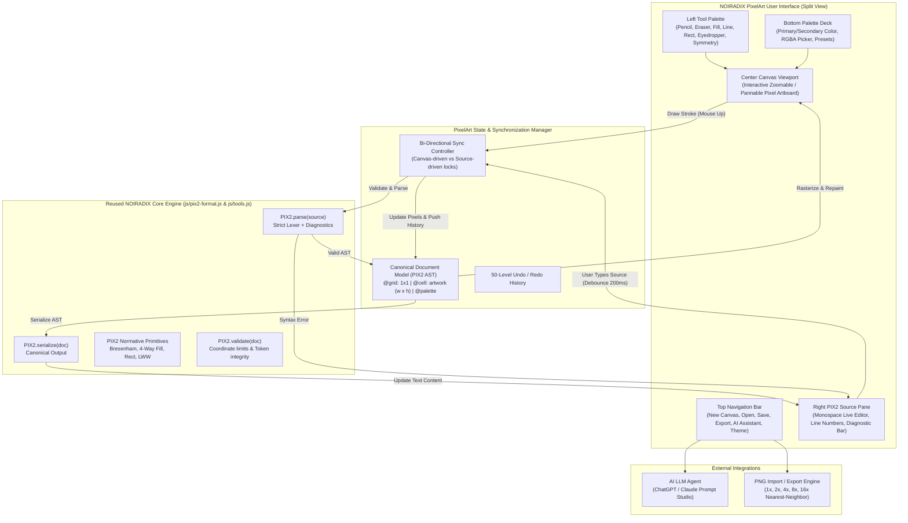

# NOIRADIX PixelArt — System Architecture & Code Reuse Plan

**Document ID:** `docs/PIXELART/ARCHITECTURE_AND_REUSE_PLAN.md`  
**Version:** 1.0.0  
**Author:** Nguyen Duc Canh (@dotlinux26) & Pair Assistant  
**Date:** 2026-11-08  
**Target URL:** `https://noiradix.me/pixelart/`  
**Status:** Approved Architectural Blueprint  

---

## 1. Executive Summary & Vision

### 1.1 The Pivot from Spritesheet Animation to Pure 2D Pixel Artwork
NOIRADIX Studio was conceived and completed as a specialized tool for indie game developers: slicing spritesheets, previewing 4-direction/8-direction walking animations, and 1-click exporting to Unity 2D (`.png` atlas + `.cs` Animator controller importer).

**NOIRADIX PixelArt** represents a sibling application in the NOIRADIX ecosystem. Rather than managing multi-frame locomotion rows or atlas spacing, PixelArt focuses on **a single standalone canvas** dedicated to pure 2D pixel art painting, illustration, and structured visual programming.

### 1.2 Core Value Proposition: The Live Bi-Directional PIX2 Code Editor
Unlike traditional paint software (Photoshop, Aseprite) where image data is locked into binary blobs, and unlike code generators where graphics cannot be edited by hand:
* **Canvas $\rightarrow$ Source:** Every stroke made with a pencil, line, rect, or flood fill instantly updates the human-readable `.pix2` source code in real time.
* **Source $\rightarrow$ Canvas:** Developers and AI agents can write or paste `.pix2` code into the live editor; the renderer parses, validates, and renders the artwork to the canvas instantly with non-destructive error handling.
* **Open Exchange Format:** Artwork is saved directly as standard `.pix2` v1.0, enabling other renderers (C++, Python, Rust, WebGL) and generative AI to read and write pixel art without dependency on any monolithic studio.

---

## 2. Component Reuse Matrix

One of the greatest advantages of building NOIRADIX PixelArt within the same repository is that **the core engine, algorithms, and data formats are already rock-solid and verified by 134 automated tests**.

| NOIRADIX Studio Component | Reused in PixelArt? | Reuse Strategy & Implementation | Notes |
| :--- | :---: | :--- | :--- |
| **`js/pix2-format.js` (PIX2 Engine)** | **100% REUSED** | Imported directly via `<script src="../js/pix2-format.js">` | `PIX2.parse()`, `PIX2.serialize()`, `PIX2.validate()`, `PIX2.drawLineBresenham()`, `PIX2.floodFillCell()`, `normalizeHex()`, `hexToRgba()`, `MAX_COORD_ABS`, `MAX_CELL_DIM`. |
| **`js/tools.js` (Algorithms)** | **90% REUSED** | Core algorithms reused: `line()`, `rect()`, `floodFill()`, `plotPixel()`, `erasePixel()`, `flipHorizontal()`, `flipVertical()`, `rotate90Clockwise()`, `nudge()`. | Extended with two-way sync hooks and dynamic canvas bounds. |
| **`js/editor-state.js` (State & History)** | **ADAPTED** | Adapted into lightweight single-cell `PixelArtState`: preserves 50-level Undo/Redo stack, primary/secondary colors, tool options, and preset palettes (`pico8`, `gameboy`, `endesga32`). | Removed multi-tab cell managers, animation playback states, and atlas grid slicing. |
| **`css/style.css` (Design System)** | **THEME REUSED** | CSS variables (`--bg-primary`, `--bg-secondary`, `--accent-primary`, `--border-subtle`, dark/light themes) shared for brand cohesion. | Custom split-view layout authored in `pixelart/css/pixelart.css`. |
| **`css/fontawesome/` & Webfonts** | **100% REUSED** | Linked directly via `<link rel="stylesheet" href="../css/fontawesome/all.min.css">` | Zero external CDN dependency; works 100% offline. |
| **`js/animation-player.js`** | **EXCLUDED (0%)** | Completely omitted from PixelArt. | PixelArt does not do sprite animation or timeline scrubbing. |
| **Atlas Grid & Unity Exporter** | **EXCLUDED (0%)** | Completely omitted from PixelArt. | No C# importer scripts, padding calculations, or slice gap logic needed. |

---

## 3. High-Level Architecture Diagram



---

## 4. Bi-Directional Synchronization Architecture

The central engineering challenge of NOIRADIX PixelArt is ensuring that editing either pane (Canvas or Code) feels instantaneous and seamless without triggering recursive feedback loops or destroying user work when typing incomplete code.

### 4.1 The Re-entrancy Lock (`isSyncing`)
```javascript
let isSyncingFromCanvas = false;
let isSyncingFromSource = false;
```
1. **Canvas-to-Source Event:**
   - User draws pixels on the canvas $\rightarrow$ `isSyncingFromCanvas = true`.
   - Update `doc.cells.artwork.pixels[x, y]`.
   - Call `PIX2.serialize(doc)`.
   - Inject serialized text into the Code Editor.
   - Update line numbers and status badge (`● Synced`).
   - Release lock: `isSyncingFromCanvas = false`.

2. **Source-to-Canvas Event:**
   - User types in Code Editor $\rightarrow$ Debounce input for 200ms.
   - If `isSyncingFromCanvas` is true, ignore event to prevent cycle.
   - Set `isSyncingFromSource = true`.
   - Call `PIX2.validate(source)` and `PIX2.parse(source)`.
   - **Case A (Valid syntax):**
     - Update document model `doc = parsedDoc`.
     - Update canvas dimension if `@grid` or `@cell size` changed.
     - Repaint canvas artboard with nearest-neighbor crisp rasterization.
     - Set status to `● Synced` (green).
     - Clear diagnostic bar.
   - **Case B (Invalid / Incomplete syntax, e.g. user half-typed `rect 10,10`):**
     - Do NOT clear the canvas! Preserve the last valid visual state.
     - Display diagnostic warning badge (`⚠ Diagnostic: Line X: Invalid syntax`) with line reference.
   - Release lock: `isSyncingFromSource = false`.

---

## 5. Canvas Dimension & Resource Policy

Following the normative limits of the PIX2 standard specification:
1. **Dimension Range:** $1 \times 1$ to $512 \times 512$ pixels.
   - Popular presets: $16 \times 16$, $24 \times 24$, $32 \times 32$, $48 \times 48$, $64 \times 64$, $96 \times 96$, $128 \times 128$, $256 \times 256$, $512 \times 512$.
   - Arbitrary custom width and height within $[1, 512]$ supported.
2. **Coordinate Abs Limits:** $|x|, |y| \le 2048$ enforced by `MAX_COORD_ABS`.
3. **Memory Safeguards:** Max steps for Bresenham is capped at 4096, and flood fill queue is capped at 65536 steps.
4. **Color Depth:** 32-bit RGBA with full alpha channel preservation ($0$ to $255$).

---

## 6. AI Pixel Art Workflow & Prompt Studio

In NOIRADIX PixelArt, AI models are treated as first-class collaborators via the PIX2 language:
1. The user selects a prompt template (e.g. *Character Portrait*, *Landscape Scene*, *Game Item*, *Dungeon Tile*).
2. The Studio embeds the current canvas size and color palette into a structured system prompt.
3. The AI model emits pure `.pix2` source code using drawing primitives (`p`, `line`, `rect`, `fill`, `sym_dot`).
4. The user pastes the code into the Editor, and the Canvas renders the AI's artwork with zero diffusion blur and zero pixel distortion.

---

## 7. Folder Structure

```
d:\ghoster\noiradix-studio/
├── pixelart/                          # Standalone PixelArt Web Application
│   ├── index.html                     # PixelArt Editor Single-Page App
│   ├── css/
│   │   └── pixelart.css               # Modern split-pane responsive styles
│   └── js/
│       └── pixelart-app.js            # Standalone PixelArt Controller & Canvas Engine
├── docs/
│   └── PIXELART/                      # Dedicated Documentation Folder
│       ├── ARCHITECTURE_AND_REUSE_PLAN.md   # This document
│       ├── SPECIFICATION.md           # Functional & UI/UX Specification
│       └── README.md                  # Project overview & Guide
├── js/                                # Core Engine (Frozen, Reused by reference)
│   ├── pix2-format.js                 # Reused directly
│   └── tools.js                       # Reused directly
└── index.html                         # NOIRADIX Studio (With lightbulb promo banner)
```

---

## 8. Summary of Engineering Commitments
1. **No Breaking Changes:** Zero alterations to the frozen PIX2 v1.0 standard syntax or the existing NOIRADIX Studio tests (134/134 tests remain green).
2. **Clean Separation:** NOIRADIX Studio remains the dedicated tool for spritesheets and Unity locomotion; NOIRADIX PixelArt serves as the dedicated tool for pure 2D illustration and live PIX2 coding.
3. **Maximum Code Reuse:** The robust, tested PIX2 core engine powers both applications with zero redundant logic.
