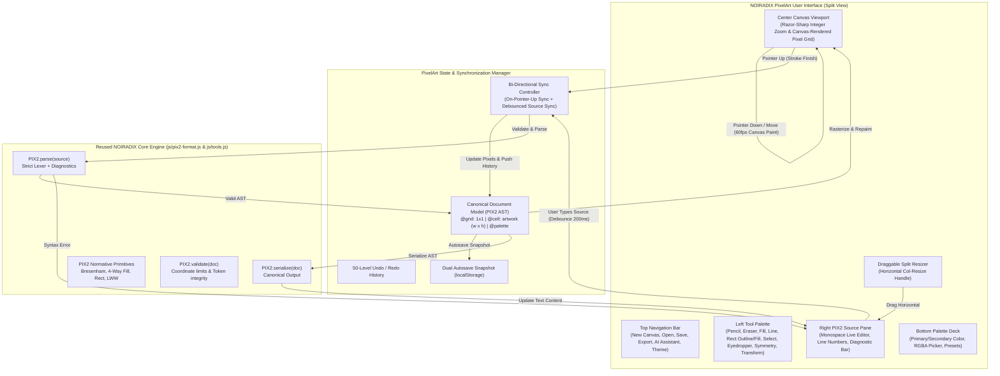

# NOIRADIX PixelArt — System Architecture & Code Reuse Plan

**Document ID:** `docs/PIXELART/ARCHITECTURE_AND_REUSE_PLAN.md`  
**Version:** 1.1.0  
**Author:** Nguyen Duc Canh (@dotlinux26) & Pair Assistant  
**Date:** 2026-11-08  
**Target URL:** `https://noiradix.me/pixelart/`  
**Status:** Approved Architectural Blueprint  

---

## 1. Executive Summary & Vision

### 1.1 The Pivot from Spritesheet Animation to Pure 2D Pixel Artwork
NOIRADIX Studio was conceived and completed as a specialized tool for indie game developers: slicing spritesheets, previewing 4-direction/8-direction walking animations, and 1-click exporting to Unity 2D (`.png` atlas + `.cs` Animator controller importer).

**NOIRADIX PixelArt** represents a sibling application in the NOIRADIX ecosystem. Rather than managing multi-frame locomotion rows or atlas spacing, PixelArt focuses on **a single standalone canvas** dedicated to pure 2D pixel art painting, illustration, and structured visual programming.

### 1.2 "Canvas là Vua, Code là Đầy Tớ" — The Human-Centered Philosophy
A human artist does not sit down to write lines of text coordinates like `p 512,320 #ff0000` — humans think in forms, colors, proportions, and strokes. In NOIRADIX PixelArt:
* **The Canvas is Primary:** Artists spend 99% of their time drawing with a mouse or pen tablet (pencil, flood fill, line, rect, selection).
* **The Code Pane is an Interface Layer:** The live `.pix2` source pane is not meant for manual typing of thousands of pixels; it serves as a lightweight interchange gateway:
  1. **Instant Copy/Paste Project Sharing:** Send an entire pixel art project across Discord or chat in lightweight text without sending binary files.
  2. **The AI Bridge:** AI models (ChatGPT, Claude) lack human motor skills but excel at emitting structured `.pix2` code. The code pane accepts AI generation and renders it instantly onto the artboard.
  3. **Batch Code Tweaks (Coder-Artist Hacks):** Quick global color replacements (find-and-replace `#ff0000` with `#00ff00`) or coordinate adjustments.

---

## 2. Component Reuse Matrix

One of the greatest advantages of building NOIRADIX PixelArt within the same repository is that **the core engine, algorithms, and data formats are already rock-solid and verified by 134 automated tests**.

| NOIRADIX Studio Component | Reused in PixelArt? | Reuse Strategy & Implementation | Notes |
| :--- | :---: | :--- | :--- |
| **`js/pix2-format.js` (PIX2 Engine)** | **100% REUSED** | Imported directly via `<script src="../js/pix2-format.js">` | `PIX2.parse()`, `PIX2.serialize()`, `PIX2.validate()`, `PIX2.drawLineBresenham()`, `PIX2.floodFillCell()`, `normalizeHex()`, `hexToRgba()`, `MAX_COORD_ABS`, `MAX_CELL_DIM`. |
| **`js/tools.js` (Algorithms)** | **100% REUSED** | All algorithms reused: `line()`, `rect()`, `floodFill()`, `plotPixel()`, `erasePixel()`, `flipHorizontal()`, `flipVertical()`, `rotate90Clockwise()`, `nudge()`, `alignCenter()`. | Core geometric algorithms reused without duplication. |
| **Selection & Marquee System** | **100% REUSED** | Brought over from Studio: bounding box marquee, Copy (`Ctrl+C`), Cut (`Ctrl+X`), Paste (`Ctrl+V`), Fill selection (`F`), Delete selection. | Provides full artwork manipulation parity. |
| **Dual Autosave & Crash Recovery** | **100% REUSED** | State automatically saved to `localStorage` snapshot on every stroke and on 20s heartbeat. | Guarantees zero work loss on accidental tab close. |
| **`css/style.css` (Design System)** | **THEME REUSED** | CSS variables (`--bg-primary`, `--bg-secondary`, `--accent-primary`, `--border-subtle`, dark/light themes) shared for brand cohesion. | Custom split-view layout authored in `pixelart/css/pixelart.css`. |
| **`css/fontawesome/` & Webfonts** | **100% REUSED** | Linked directly via `<link rel="stylesheet" href="../css/fontawesome/all.min.css">` | Zero external CDN dependency; works 100% offline. |
| **`js/animation-player.js`** | **EXCLUDED (0%)** | Completely omitted from PixelArt. | PixelArt does not do sprite animation or timeline scrubbing. |
| **Atlas Grid & Unity Exporter** | **EXCLUDED (0%)** | Completely omitted from PixelArt. | No C# importer scripts, padding calculations, or slice gap logic needed. |

---

## 3. High-Level Architecture Diagram



---

## 4. Bi-Directional Synchronization Architecture

### 4.1 On-Pointer-Up Synchronization Policy
To guarantee sustained 60fps drawing responsiveness — even on $1024 \times 1024$ canvases with thousands of pixels:
1. **During `pointermove`:** The application draws directly into the canvas bitmap buffer. **Zero serialization occurs while dragging.** This keeps CPU overhead under 1ms per frame.
2. **On `pointerup`:** Once the stroke finishes, the document AST is updated, a history snapshot is recorded, and `PIX2.serialize(doc)` updates the source pane.
3. **Re-entrancy Lock (`isSyncing`):** Prevents recursive loops between the canvas and textarea.

### 4.2 Non-Destructive Source-to-Canvas Parsing
When an artist or AI pastes code into the editor:
* Input is debounced by 200ms.
* `PIX2.validate()` checks token and structural validity.
* **If valid:** The document AST updates, canvas dimensions adjust automatically, and the artboard repaints.
* **If invalid:** The canvas maintains the last valid artwork without clearing or corrupting the drawing, while the status pill surfaces the exact error code (e.g. `PIX2_ERR_INVALID_COORD`).

---

## 5. Canvas Dimensions & 1024×1024 Hardware Sweet Spot

### 5.1 Native Browser & Hardware Performance Math
Why $1024 \times 1024$ is the optimal ceiling for browser-native Vanilla JavaScript:
* **RAM Footprint:** $1024 \times 1024 = 1,048,576\text{ pixels}$. In a 32-bit RGBA `Uint32Array` or `ImageData`, the entire canvas buffer requires exactly **4 MB of RAM**. Modern devices have 8GB–32GB RAM, making 4MB virtually imperceptible.
* **GPU Texture Optimization:** $1024$ is a power-of-two ($2^{10}$). Modern graphics chips (NVIDIA, AMD, Apple Metal, Intel Iris) optimize texture memory alignment specifically around power-of-two dimensions, delivering hardware-accelerated bilinear blits with zero penalty.
* **CPU Primitive Steps:** Bresenham lines at maximum diagonal span at most 1024 iterations, executing in under 0.2ms in V8.

### 5.2 Canvas Dimension Presets
* Micro & Game Sprites: $16 \times 16$, $24 \times 24$, $32 \times 32$, $48 \times 48$, $64 \times 64$
* Medium & Widescreen 16:9: $128 \times 128$, $192 \times 108$ (16:9), $256 \times 256$, $320 \times 180$ (16:9)
* Large & Hi-Bit: $512 \times 512$, $1024 \times 1024$
* Arbitrary custom width and height up to $1024 \times 1024$ supported.

---

## 6. High-Precision Razor-Sharp Grid Rasterization

Previous CSS-based background-image grid implementations suffered from subpixel floating-point drift and phase misalignment when zoomed.

In NOIRADIX PixelArt:
* The canvas buffer dimensions are set directly to `state.w * state.zoom` and `state.h * state.zoom`.
* Every pixel is drawn as an exact integer block of `zoom × zoom` pixels:
  ```javascript
  ctx.fillRect(px * zoom, py * zoom, zoom, zoom);
  ```
* Pixel grid lines are rendered with **half-pixel $(+0.5\text{px})$ offset** directly onto the canvas:
  ```javascript
  ctx.moveTo(Math.floor(x * zoom) + 0.5, 0);
  ctx.lineTo(Math.floor(x * zoom) + 0.5, totalH);
  ```
* This guarantees 100% mathematical grid alignment at every zoom level $\ge 8\times$ with zero subpixel blurring.

---

## 7. Draggable Split Pane Resizer

Between the artboard and code editor sits a draggable divider (`#pa-split-resizer`):
* Allows users to dynamically shrink the code pane when focused on painting, or expand it when reviewing source or AI output.
* Clamped between 200px and `window.innerWidth - 300px`.
* Width preference is automatically persisted in `localStorage ('pix2_pixelart_panel_width')`.

---

## 8. Summary of Engineering Commitments
1. **Complete Parity with Studio:** Selection marquee, Cut/Copy/Paste/Fill, Rotate 90°, Flip H/V, Center content, Arrow key nudge, and Dual Autosave are fully supported.
2. **Standard Iconography:** Filled rectangle uses the standard solid square (`fa-solid fa-square`), distinct from marquee selection (`fa-crop-simple`).
3. **No Breaking Changes:** The PIX2 v1.0 Standard and NOIRADIX Studio remain frozen and verified by 134 automated unit and security tests.
