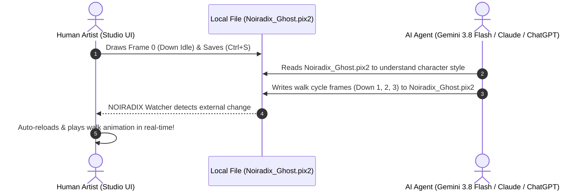

# PIX2 AI Authoring & Cognitive Reference Guide v1.0
## Instructions for Large Language Models & Autonomous Agents

> **Audience:** Any AI agent, LLM, or programmatic code generator tasked with creating, reading, validating, or modifying pixel art sprites.  
> **Key Principle:** PIX2 is not an image prompt. It is deterministic, addressable sprite code.

---

## 1. The Core Mental Model for AI

When you are asked to "create a sprite" or "modify a sprite" in PIX2:
1. **Never generate an image or diffusion matrix.** You are writing structured PIX2 code.
2. **Every pixel is a discrete integer coordinate $(x, y)$.**
3. **Never generate an implicit background.** Transparent pixels do NOT exist in the file. Only drawn pixels exist.
4. **Coordinate Origin:** Top-left is $(0, 0)$.
   - $X$ increases from left to right: $0 \le x < \text{width}$.
   - $Y$ increases from top to bottom: $0 \le y < \text{height}$.
5. For a standard $16 \times 16$ sprite cell, valid indices are $x \in [0, 15]$ and $y \in [0, 15]$.

---

## 2. Standard PIX2 File Template

Every `.pix2` file generated by an AI must follow this canonical structure:

```pix2
@pix2 1.0

@meta
  title: "Player"
  author: "dotlinux26"
  version: "1.0"
  color_mode: "RGBA"
  coordinate_origin: "top-left"

@grid
  columns: 4
  rows: 4
  default_cell: 16x16
  gap: 1
  background: none

@palette
  white: #FFFFFF
  outline: #57546F
  shade: #DDE8EF
  blush: #FFB0BC
  eye: #46435C

@cell down_0
  name: "Down Idle 0"
  direction: down
  frame: 0
  size: 16x16

  ; Head dome
  pixel 6,2 outline
  pixel 7,2 white
  pixel 8,2 white
  pixel 9,2 outline

  ; Eyes & face
  pixel 5,3 outline
  pixel 6,3 white
  pixel 7,3 eye
  pixel 8,3 eye
  pixel 9,3 white
  pixel 10,3 outline

@animation walk_down
  name: "Walk Down"
  direction: down
  frames: [down_0, down_1, down_2, down_3]
  fps: 6
  loop: true

@end
```

---

## 3. Surgical AI Operations (Pixel Addressing)

When an AI receives an editing instruction, it MUST perform surgical operations rather than rewriting unrelated parts.

### Operation 1: Set Pixel (`set_pixel`)
To set a pixel at coordinate $(x, y)$ in cell `cell_id`:
```
Player.down_0.pixel(7, 3) = #FFFFFF
```
In PIX2 syntax:
```pix2
@cell down_0
  pixel 7,3 #FFFFFF
```

### Operation 2: Erase Pixel (`erase_pixel`)
To make a pixel transparent at coordinate $(x, y)$, **simply remove its record**:
```
erase Player.down_0.pixel(7, 3)
```
*(In PIX2, non-existent coordinate = 100% transparent)*.

### Operation 3: Replace Color (`replace_color`)
To recolor all occurrences of a palette color:
```
replace_color(cell: down_0, from: outline, to: #222233)
```

### Operation 4: Move / Shift Region (`move_region`)
To translate a bounding box $(\Delta x, \Delta y)$:
For every $(x, y)$ in region, replace with $(x + \Delta x, y + \Delta y)$.

### Operation 5: Symmetry Mirror (`mirror_cell`)
For a horizontal symmetry axis $X_{\text{axis}} = \frac{W - 1}{2}$:
For each pixel at $(x, y)$, mirror coordinate is $(2 \cdot X_{\text{axis}} - x, y) = (W - 1 - x, y)$.

---

## 4. Designing Characters from Scratch (AI Step-by-Step Recipe)

When creating a $16 \times 16$ RPG character:
1. **Determine Silhouette Boundaries:**
   - Head top: $Y \approx 1 \dots 3$, Width $\approx 6 \dots 10$ ($X \in [3, 12]$).
   - Eyes: $Y \approx 6 \dots 7$, spaced 2-3 pixels apart.
   - Body torso: $Y \approx 8 \dots 11$, Width $\approx 8 \dots 12$.
   - Feet / Shadow: $Y \approx 13 \dots 14$.
2. **Assign 4 to 8 Colors in `@palette`:**
   - `outline`: Dark contour (e.g. `#57546F` or `#2A2B3D`).
   - `body`: Primary fill (e.g. `#FFFFFF` or `#FF8844`).
   - `shade`: Secondary shadow fill (e.g. `#DDE8EF`).
   - `accent`: Eyes, blush, accessories.
3. **Generate Directional Frames:**
   - `down_0` (Facing front/camera): Symmetrical face, two eyes visible.
   - `up_0` (Facing away/back): Back of head/hair, no eyes visible.
   - `right_0` (Facing right): Profile view, one eye visible at right edge, nose/snout offset.
   - `left_0` (Facing left): Exact horizontal mirror of `right_0`.
4. **Create Walking Animation:**
   - Frame 0: Idle contact pose.
   - Frame 1: Left foot step forward ($Y_{\text{bob}} - 1$).
   - Frame 2: Passing pose.
   - Frame 3: Right foot step forward ($Y_{\text{bob}} - 1$).

---

## 5. Anti-Hallucination Guardrails for AI

1. **NEVER output background fill:** Do NOT fill the remaining coordinates $0 \dots 15$ with black, white, or `#000000`. Leaving them out guarantees true transparency.
2. **NEVER exceed cell boundaries:** For $16 \times 16$, $x \ge 16$ or $y \ge 16$ is an invalid coordinate and will fail validation.
3. **NEVER discard alpha:** If a semi-transparent blush or shadow is used (e.g. `#FFB0BC80`), preserve the 8-digit hex.
4. **DO NOT invent non-existent frame references:** In `@animation walk_down`, ensure all frame names in `frames: [ ... ]` exist as defined `@cell` records.

---

## 6. The 4 Specialized AI Prompt Templates

NOIRADIX Studio equips artists and LLMs with 4 context-tailored prompt modes selectable directly from the Studio interface:

### Mode 1: Full Character (4-Dir / 8-Dir Generation)
* **Goal:** Generate a complete game character from scratch with directional faces and walk animations.
* **Instructional Focus:**
  - Establishes a harmonious 4 to 8 color `@palette` (Outline, Base, Highlight, Shadow, Accents).
  - Enforces bilateral symmetry on frontal views (`down_0`) using `sym_dot`.
  - Enforces silhouette consistency across all 4 cardinal directions (`down`, `up`, `right`, `left`).
  - Automatically hooks up walk cycles (`walk_down`, `walk_up`, `walk_right`, `walk_left`) at 6fps loop.

### Mode 2: Walk Cycle & Locomotion Animation
* **Goal:** Produce smooth, natural locomotion frames from a static reference pose.
* **Instructional Focus:**
  - Discrete bobbing physics: Frame 1 & Frame 3 apply a 1-pixel torso offset ($\Delta Y = -1$) to simulate step impact.
  - Foot swing dynamics: Leading foot stretches forward, trailing foot pulls back with passing contact.
  - Secondary motion: Cloaks, tails, antennae, and hair trailing motion lagged by 1 frame.

### Mode 3: Accessory & Equipment Overlay
* **Goal:** Equip characters with hats, helmets, wings, cloaks, and weapons without breaking base silhouette.
* **Instructional Focus:**
  - Non-destructive overlays: Preserves existing character anatomy pixels unless intentionally covered.
  - Primitives: Utilizes `line x0,y0 x1,y1 <color>` for weapon handles and blades.
  - Palette integration: Adds distinct material colors (e.g. golden steel, polished silver, ruby gems).

### Mode 4: Surgical Frame / Color Patch
* **Goal:** Apply targeted fixes to specific cells or color schemes with minimal token consumption.
* **Instructional Focus:**
  - Output ONLY modified `@cell <id>` or `@palette` directives rather than regenerating the entire document.
  - Eliminates regression risks on unrelated frames and reduces LLM latency.

---

## 7. Real-Time Human-AI Live Collaboration Protocol

NOIRADIX Studio supports bidirectional, zero-latency co-authoring between human artists and AI agents:



### Best Practices for AI Agents Writing to Disk:
1. **Preserve Document Metadata:** Keep existing `@meta` title, grid dimensions, and cell dimensions untouched unless requested.
2. **Reuse Existing Palette IDs:** If white is defined as `1`, do not define a duplicate white as `6`.
3. **Format Determinism:** Keep `@cell` declarations in sequential grid order (`cell_0_0`, `cell_0_1`, etc.).
4. **Single-File Completeness:** Ensure the written `.pix2` file passes `PIX2.validate()` without dangling frame references.
